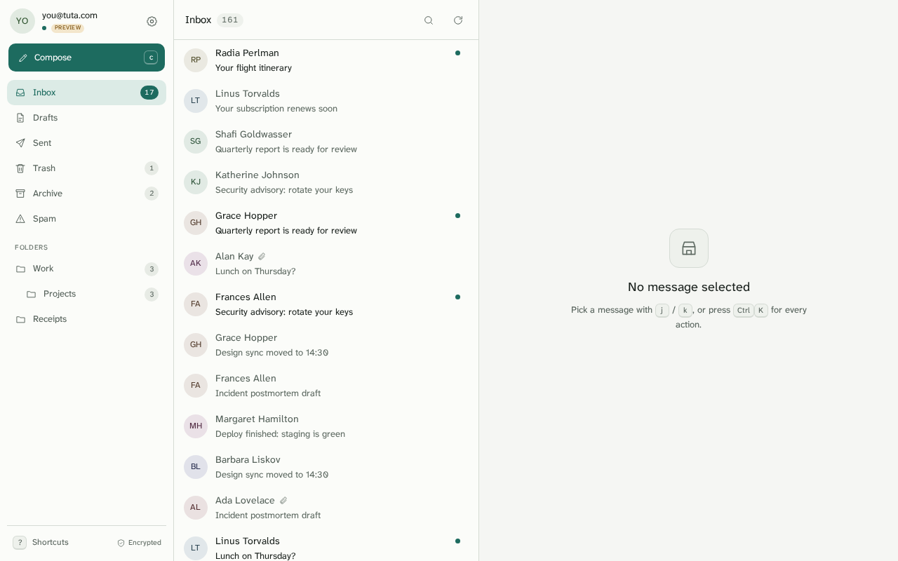
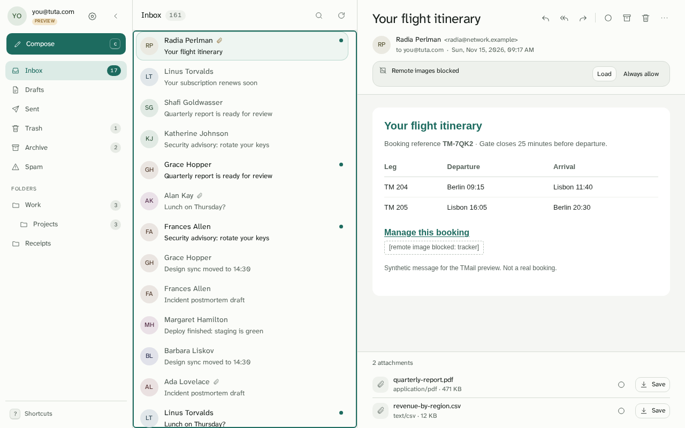
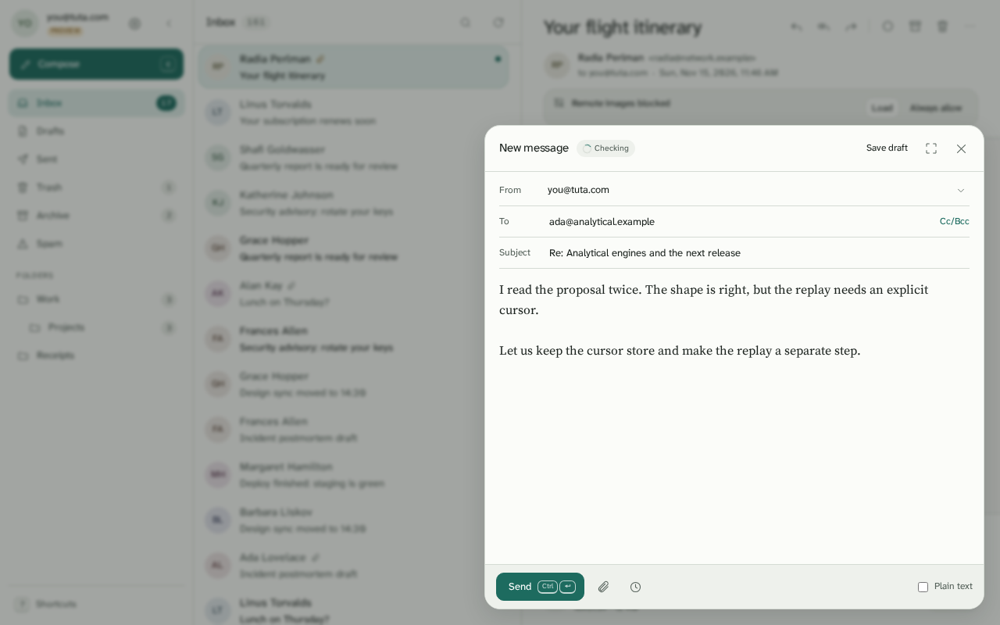
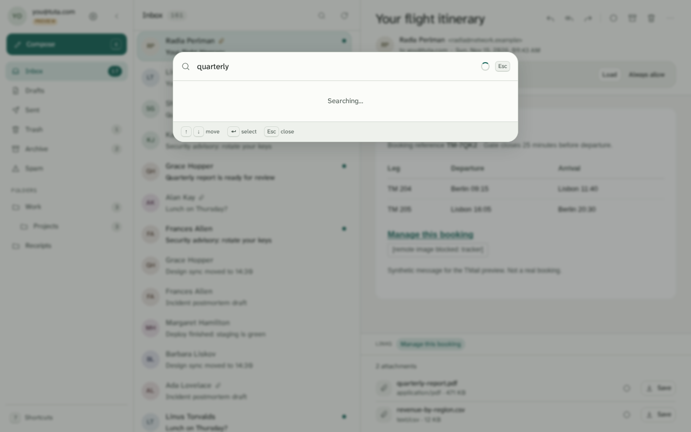
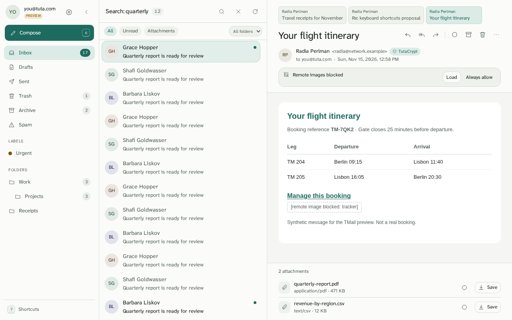
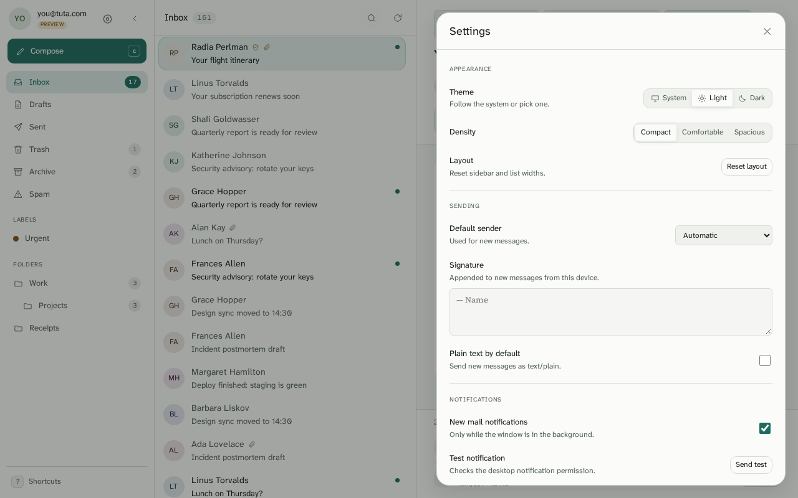
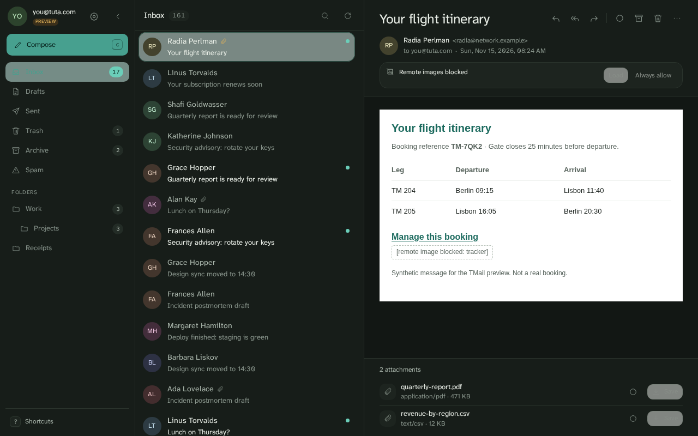

<p align="center">
  
</p>

<p align="center">
  <a href="LICENSE"></a>
  
  
</p>

> **Unofficial.** TMail is not affiliated with, endorsed by or supported by
> Tutao GmbH. “Tuta” is used only to describe the service this client connects
> to. No Tuta logo or branding is used.

TMail is a keyboard-first desktop client for [Tuta Mail](https://tuta.com),
built with **Rust** and **Tauri 2**. It keeps Tuta’s end-to-end encryption intact
while treating the mailbox as a local, encrypted database: instant scrolling,
local full-text search, offline reading of messages you have opened, and a
reader that never loads a tracking pixel by itself.

---

## Screenshots

> Synthetic demo mailbox. No real account content is shown.

### Inbox — overview



### Reader



### Composer



### Command palette



### Search



### Settings



### Dark theme



### Mobile inbox


---

## Why TMail?

| | TMail |
|---|---|
| **Native, not a browser tab** | Tauri 2 window, tray, native notifications, `mailto:` handler and a system keyring session. Small Rust core, web UI only for rendering. |
| **Local-first** | Encrypted SQLCipher cache and FTS5 search. Lists and opened bodies answer from disk before the network. |
| **Keyboard-first** | `j/k` navigation, `u/e/#`, `r/a/f`, `g` folder jumps, `Ctrl+K` command palette, full shortcut sheet. |
| **Mail looks like mail** | Safe sender CSS, tables and legacy markup are preserved. Remote images and tracking pixels stay blocked per sender. |
| **Find and understand** | Full search view with filters, conversation strips, contact autocomplete and trust badges for TutaCrypt/RSA/AES. |
| **Encryption without rituals** | Automatic E2E for Tuta recipients, including **Tuta-hosted custom domains**. No manual “confidential” checkbox for Tuta users. |
| **Compose that fits a desktop** | Sender aliases, scheduled send, attachments, image/text previews, plain-text mode, signature, Gmail-style composer. |
| **Quiet by default** | No telemetry or analytics. Mail traffic only goes to Tuta hosts; the optional signed updater contacts GitHub Releases. |
| **Yours to keep** | GPL-3.0-or-later, reproducible Rust/pnpm locks, packages for your distro and plain source builds. |

TMail does **not** replace everything in the official client yet. Missing:
rich-text compose, editing an existing draft, contacts, calendar, inbox-rule
UI, and password-protected external mail. Server-side settings such as vacation
replies and templates are one click away in Tuta web from the settings sheet.
See [`docs/FEATURE-MATRIX.md`](docs/FEATURE-MATRIX.md) and
[`docs/STATUS.md`](docs/STATUS.md).

---

## Install

Prebuilt packages are attached to every GitHub Release. Linux bundles are
built on Ubuntu 22.04 (glibc 2.35+) so they run on Ubuntu 22.04+, Debian 12+ and
their derivatives. Pick the format for your system:

| System | Package | Notes |
|---|---|---|
| Arch Linux | `.AppImage` (or build from source) | A `PKGBUILD` template is in [`packaging/`](packaging/). |
| Debian / Ubuntu | `.deb` | Built on Ubuntu 22.04 (glibc 2.35+). Requires WebKitGTK 4.1. |
| Fedora | `.rpm` | Requires `webkit2gtk4.1` and `gtk3`. |
| openSUSE | `.rpm` or `.AppImage` | `webkit2gtk4.1` from the distribution. |
| Other Linux | `.AppImage` | Needs `webkit2gtk-4.1`, `gtk3`; on Ubuntu 22.04 also `libfuse2`. |
| Windows 10/11 | `.exe` (NSIS) or `.msi` | Unsigned; SmartScreen may warn. |
| macOS | `.dmg` | Universal build; unsigned, Gatekeeper may warn. |

### Debian / Ubuntu

```bash
# Download TMail_*.deb from the Releases page, then:
sudo apt install ./TMail_*.deb
tmail
```

### Fedora

```bash
# Download TMail-*.rpm from the Releases page, then:
sudo dnf install ./TMail-*.rpm
tmail
```

### openSUSE

```bash
# Download TMail-*.rpm from the Releases page, then:
sudo zypper install ./TMail-*.rpm
tmail
```

### Arch Linux

Use the AppImage for a quick start:

```bash
chmod +x TMail_*.AppImage
./TMail_*.AppImage
```

Or build the package from this repository:

```bash
git clone <repository-url> TMail-for-Tuta
cd TMail-for-Tuta
cd packaging
makepkg -si
```

The `PKGBUILD` expects the source tarball matching the requested version in the
current directory (or update `source=` to the release archive). A native AUR
package is planned; do not assume `yay -S tmail` works until it is published.

### Generic AppImage

```bash
chmod +x TMail_*.AppImage
./TMail_*.AppImage
```

If your distribution has FUSE 2, the AppImage runs directly. Otherwise:

```bash
sudo apt install libfuse2        # Ubuntu 22.04 / Debian 12
./TMail_*.AppImage --appimage-extract-and-run
```

The AppImage still uses the system WebKitGTK 4.1; it does not bundle a browser
engine.

### Windows / macOS

- **Windows:** run `TMail_<version>_x64-setup.exe` (NSIS) or the `.msi`.
- **macOS:** open the `.dmg` and drag TMail to Applications.

Builds are not code-signed. On Windows, choose “More info → Run anyway” only if
you trust the build; on macOS, right-click → Open the first time.

### First start

1. Enter your Tuta address and password. TOTP is supported; U2F/WebAuthn is
   not yet.
2. The session is stored in the **Secret Service** (GNOME Keyring / KWallet).
   The password itself is never stored.
3. If no keyring is available, TMail keeps the session in memory and says so.
4. The encrypted cache lives in `$XDG_DATA_HOME/tmail`. Tuta’s WebView storage
   lives in `~/.local/share/de.tmail.TMail` on Linux.
5. Use only a dedicated test account for development; never point tests or
   destructive checks at a real mailbox.

---

## Build from source

Requirements: Rust 1.85+, Node.js 22+, pnpm 10+, and the platform WebView
dependencies.

### Arch Linux

```bash
sudo pacman -S --needed base-devel rust nodejs pnpm \
  webkit2gtk-4.1 gtk3 libsoup3 openssl libappindicator-gtk3 librsvg
pnpm install --frozen-lockfile
pnpm tauri build
```

### Debian / Ubuntu

```bash
sudo apt update
sudo apt install -y build-essential curl wget file libssl-dev \
  libwebkit2gtk-4.1-dev libayatana-appindicator3-dev librsvg2-dev libxdo-dev
# Node 22 + pnpm via your preferred method; then:
pnpm install --frozen-lockfile
pnpm tauri build
```

### Fedora

```bash
sudo dnf install -y gcc gcc-c++ make curl wget file openssl-devel \
  webkit2gtk4.1-devel gtk3-devel libsoup3-devel \
  libappindicator-gtk3-devel librsvg2-devel libxdo-devel
pnpm install --frozen-lockfile
pnpm tauri build
```

Bundles are written below `target/release/bundle/` (macOS universal:
`target/universal-apple-darwin/release/bundle/`):

```
deb/       .deb package
rpm/       .rpm package
appimage/  .AppImage
nsis/      Windows .exe installer
msi/       Windows .msi
dmg/       macOS disk image
```

For a binary without packaging:

```bash
pnpm tauri build --no-bundle
```

If AppImage bundling fails locally, unset `LD_LIBRARY_PATH` first. Tools such as
VMware can inject foreign `libgdk_pixbuf` libraries and make `linuxdeploy` look
for libraries that are not part of the distribution:

```bash
env -u LD_LIBRARY_PATH pnpm tauri build
```

### Development

```bash
pnpm install --frozen-lockfile
pnpm tauri dev
```

Do **not** run `pnpm -C ui build` or `pnpm -C ui check` while `tauri dev` is
running; both rewrite `.svelte-kit` and can corrupt the dev server’s CSS/HMR
state. Stop the dev server first.

```bash
cargo test -p tmail-core
cargo clippy --workspace --all-targets --no-deps -- -D warnings
pnpm -C ui check
pnpm -C ui test
pnpm -C ui exec playwright test --reporter=line
```

Live integration tests require `TMAIL_TEST_EMAIL` and `TMAIL_TEST_PASSWORD` for
a dedicated account and are skipped otherwise. See [`docs/SMOKE.md`](docs/SMOKE.md).

---

## Releases

The release workflow lives in
[`.github/workflows/release.yml`](.github/workflows/release.yml). Push a tag:

```bash
git tag v0.2.1
git push origin v0.2.1
```

GitHub Actions builds on Ubuntu 24.04, Windows and macOS (universal), creates a
**draft** release and attaches the `.deb`, `.rpm`, `.AppImage`, `.exe`, `.msi`
and `.dmg` bundles. Review the draft, then publish it. No binary is published
without a tag.

Packages are currently unsigned. Signing keys can be added later via the
documented Tauri signing secrets; the workflow deliberately does not pretend to
be signed.

---

## Security

- **E2E:** every key operation is done by the official GPL Tuta SDK; TMail never
  implements its own cryptography.
- **Cache:** SQLCipher, key derived from the Tuta group key (ADR 0004).
- **Session:** Secret Service (GNOME Keyring / KWallet); no plaintext fallback.
- **Mail renderer:** sanitised HTML in a hash-pinned, sandboxed frame with an
  opaque origin. Scripts and remote content are blocked by default; inline
  sender CSS is filtered for `url()`, fixed positioning and animation.
- **Links:** the frame forwards clicks through a hash-pinned bootstrap to the
  trusted parent; the parent opens them with the system browser.
- **Network:** Tuta-owned host allowlist, bounded concurrency and backoff on
  429/5xx. The optional signed updater contacts GitHub Releases; package-managed
  Linux installs use their package manager. No telemetry or crash reporting.
- **Attachments:** decrypted only on demand; image/text previews stay in-app,
  everything else is saved through the native dialog.

---

## Project

- [`PRODUCT.md`](PRODUCT.md) — users, purpose and principles.
- [`DESIGN.md`](DESIGN.md) — visual system and tokens.
- [`docs/FEATURE-MATRIX.md`](docs/FEATURE-MATRIX.md) — what works and what doesn’t.
- [`docs/STATUS.md`](docs/STATUS.md) — current phase and known gaps.
- [`docs/adr/`](docs/adr/) — architecture decisions.
- [`docs/SMOKE.md`](docs/SMOKE.md) — live-account checklist.
- [`docs/LEGAL.md`](docs/LEGAL.md) — unofficial status, trademarks, Tuta ToS.
- [`NOTICE.md`](NOTICE.md) — upstream and adapted code attribution.

## License

GPL-3.0-or-later. The vendored Tuta SDK and adapted tutabridge material are
GPL-3.0; see [`LICENSE`](LICENSE), [`NOTICE.md`](NOTICE.md) and
[`docs/adr/0005-license.md`](docs/adr/0005-license.md).
